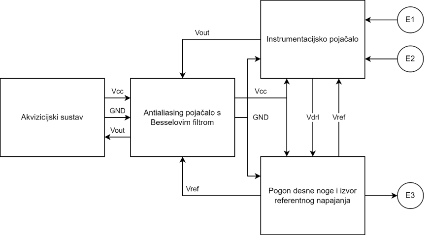
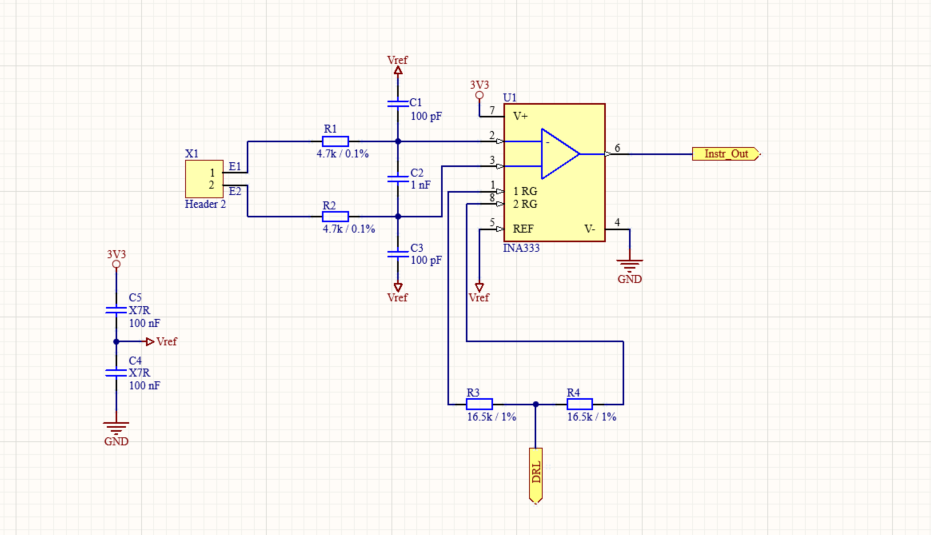
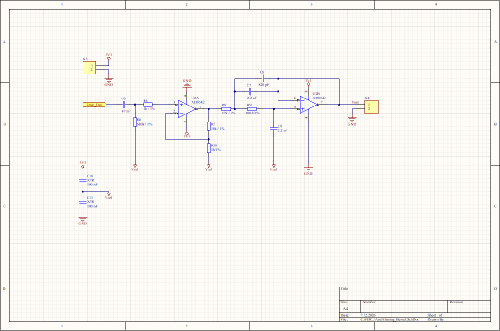
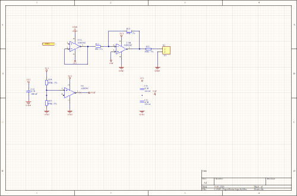

# Analogni prednji stupanj za EKG

Završni rad (FER, preddiplomski studij). Ovo je analogni sklop za snimanje EKG signala s tri elektrode, napravljen u Altium Designeru: instrumentacijsko pojačalo, antialiasing pojačalo s Besselovim filtrom te pogon desne noge (DRL) s izvorom referentnog napona.



## Blokovi sklopa

| Blok | Shema | Opis |
|---|---|---|
| Instrumentacijsko pojačalo | `Instr_pojacalo.SchDoc` | INA333 pojačava diferencijalni signal s elektroda E1 i E2 |
| Antialiasing pojačalo | `AntiAliasing_Bessel.SchDoc` | Dodatno pojačanje i Besselov niskopropusni filtar prije akvizicijskog sustava (AD8542) |
| Pogon desne noge | `PogonDesneNoge.SchDoc` | DRL na elektrodu E3 i referentni napon Vref za cijeli sklop |
| Vršna shema | `Top.SchDoc` | Povezuje sve blokove |



| Antialiasing pojačalo | Pogon desne noge |
|---|---|
|  |  |

## Struktura repozitorija

```
Altium/         Altium projekt (Projekt_E.PrjPcb, sheme, PCB1.PcbDoc, BOM .xlsx)
docs/           slike za dokumentaciju
```

Projekt se otvara u Altium Designeru preko `Altium/Projekt_E.PrjPcb`.

## Popis komponenti (BOM)

BOM s kataloškim brojevima i cijenama (Mouser) je u [`Altium/Projekt_E.xlsx`](Altium/Projekt_E.xlsx). Komponente koštaju ukupno oko **15,17 €**.

## Autor

Lovro Rosandić, FER
